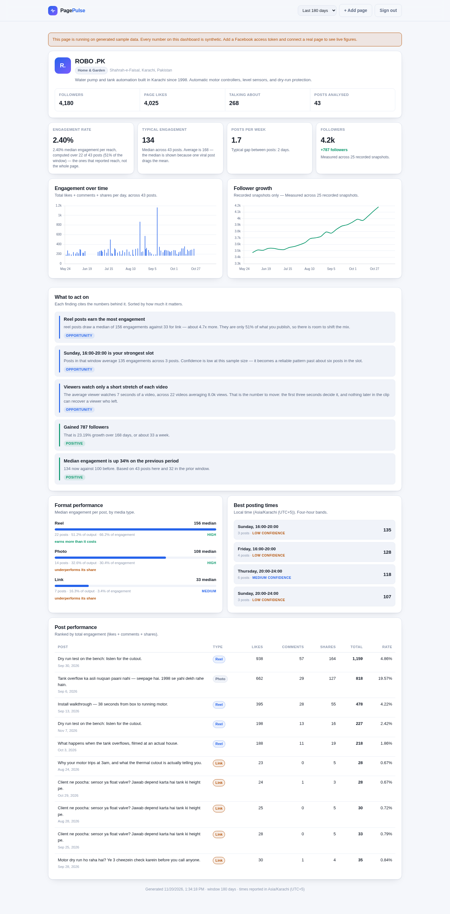
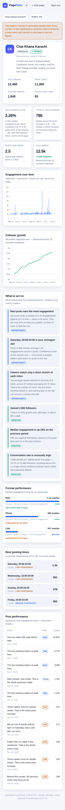
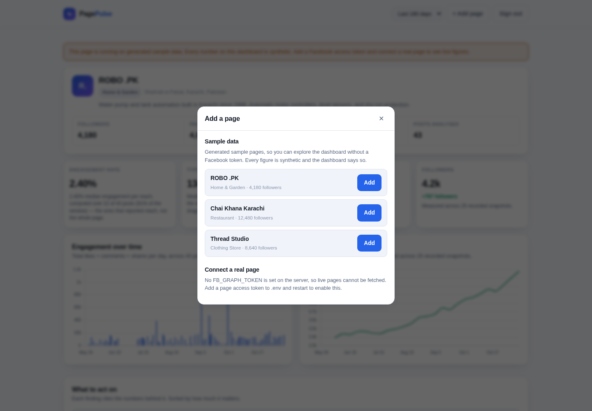
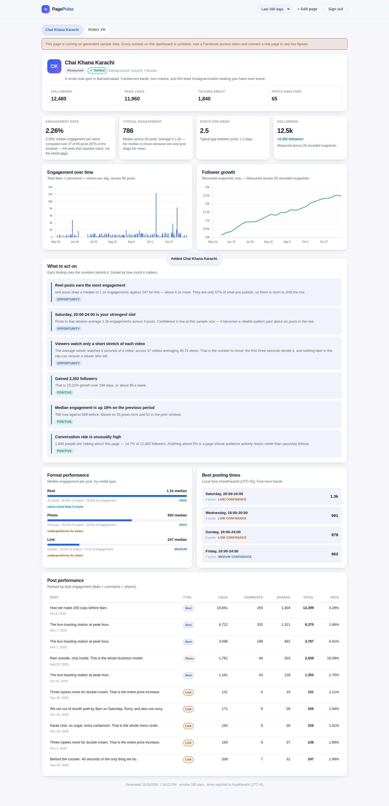

# Page Pulse

**Facebook page analytics that show their working.**

Every number in this dashboard tells you what it measured and over how many
posts. No metric appears without its denominator, and no finding appears
without the figures behind it.



---

## Why this exists

Most page analytics tools hand you a number and expect trust. "Engagement rate:
2.4%." Over what? Which posts? Does that include the reels that report reach
and the photos that don't?

That last question is not academic. If your reels report reach and your photos
don't, a naive tool computes the rate over the reels only and presents it as
your page's engagement rate. You then compare it against a benchmark, make a
decision, and the decision is wrong — not because the arithmetic was wrong, but
because the denominator was never stated.

Page Pulse states it. Every time.

---

## What you get

**Page overview** — followers, likes, talking-about, posts analysed, category,
verification status.

**Key metrics** — engagement rate (with its sample size), typical engagement
(median, with the mean alongside so you can see the skew), posting cadence
(posts/week plus the longest gap), and follower growth.

**Two charts** — engagement per day, and follower growth from recorded
snapshots only. The follower line does not interpolate days that were never
measured.

**Findings** — rules that fire only when they can cite a number, sorted by
severity. Each one names the figures it used.

**Format performance** — share of engagement against share of output, per media
type. A format that is 25% of your posts and 60% of your engagement is worth
more of.

**Best posting times** — four-hour weekday bands, each with a confidence level.
Thin bands are marked `insufficient` rather than being presented as a pattern.

**Post table** — top and weakest posts by total engagement, with per-post rate.

---

## Screenshots

| Desktop | Mobile |
|---|---|
|  |  |

| Add a page | Second page |
|---|---|
|  |  |

---

## Quick start

Requires Python 3.11 or newer. No Node, no build step, no external services.

```bash
cd facebook-page-analyzer

python -m venv .venv
source .venv/bin/activate          # Windows: .venv\Scripts\activate

pip install -r requirements.txt

cp .env.example .env
python -c "import secrets; print('SECRET_KEY=' + secrets.token_urlsafe(48))" >> .env

python -m scripts.seed             # creates a demo account and three sample pages
uvicorn app.main:app --reload
```

Open **http://127.0.0.1:8000** and sign in:

```
email     abraz@example.com
password  pagepulse-demo-2026
```

That is the whole setup. The database is a SQLite file created on first run.

### Without the seed script

Skip `python -m scripts.seed`, open the app, click **Create account**, then
**+ Add page** and pick one of the three sample pages. Same result.

---

## Docker

```bash
cp .env.example .env
# put a real SECRET_KEY in .env first — compose refuses to start without one
docker compose up --build
```

That brings up PostgreSQL and the app on **http://127.0.0.1:8000**. The
database is a named volume, so it survives `docker compose down`.

---

## Connecting a real page

The app runs on sample data out of the box. To pull live data you need a
Facebook **page access token** for a page you administer.

1. Create an app at [developers.facebook.com](https://developers.facebook.com).
2. Request these permissions: `pages_read_engagement`, `pages_show_list`,
   `read_insights`.
3. Get a page access token from the Graph API Explorer.
4. Put it in `.env`:

```env
FB_GRAPH_TOKEN=EAAB...
```

5. Restart the server. The **+ Add page** dialog now shows a "Connect a real
   page" field — enter the numeric page ID.

**What the Graph API actually returns, and what it doesn't.** Page-level
`insights` (reach, impressions, demographics) requires a token with
`read_insights` *and* the page must have enough followers for Facebook to
report them. When those numbers are absent, the app falls back to follower-based
rates and labels them as such. It does not invent reach.

If the token is missing or lacks permission, the API returns **503** with a
message saying exactly that — not a fake success.

---

## Importing your own data

If you have post data from somewhere else, post it directly:

```bash
curl -X POST http://127.0.0.1:8000/api/pages/1/import \
  -H "Authorization: Bearer $TOKEN" \
  -H "Content-Type: application/json" \
  -d '[
    {
      "external_id": "post-1",
      "message": "Our new controller is in stock",
      "media_type": "photo",
      "posted_at": "2026-11-01T10:00:00Z",
      "likes": 42,
      "comments": 3,
      "shares": 1,
      "reach": 900
    }
  ]'
```

The endpoint upserts on `external_id`, so re-importing the same post updates it
rather than duplicating it. It returns **200**, not 201, for that reason.

---

## API

Full reference: [`docs/API.md`](docs/API.md). Interactive docs at `/docs` while
the server is running.

| Method | Path | Purpose |
|---|---|---|
| `GET` | `/health` | Liveness, plus whether a Graph token is configured |
| `POST` | `/api/auth/register` | Create an account → JWT |
| `POST` | `/api/auth/login` | Sign in → JWT |
| `GET` | `/api/auth/me` | Current user |
| `GET` | `/api/pages` | Your pages |
| `GET` | `/api/pages/demo` | The sample-page catalogue |
| `POST` | `/api/pages/demo` | Add a sample page |
| `POST` | `/api/pages/live` | Connect a real page (needs a token) |
| `GET` | `/api/pages/{id}` | One page's profile |
| `GET` | `/api/pages/{id}/analysis` | The full analysis |
| `POST` | `/api/pages/{id}/import` | Import posts as JSON |
| `GET` | `/api/pages/{id}/imports` | Import history |
| `DELETE` | `/api/pages/{id}` | Remove a page and its data |

---

## Tests

```bash
pytest              # 57 tests, ~10s
ruff check app tests scripts
ruff format --check app tests scripts
```

The analytics tests need no database and no network — the engine is pure
functions over dataclasses. Several of them exist specifically to pin bugs that
were found by running the engine rather than by reading it:

- `test_watch_time_is_per_view_not_a_raw_total` — `watch_seconds` is a total
  across all views. Reporting it raw gave a median of 600 seconds against
  sub-minute clips.
- `test_time_slots_use_four_hour_bands_not_single_hours` — a 48-post page has at
  most two posts per exact hour, so an hour-level "best time" is the best single
  post wearing a pattern's clothes.
- `test_engagement_summary_reports_its_own_sample_size` — the rate is computed
  over posts that reported reach, and the sentence must say so.
- `test_growth_percent_is_none_when_baseline_is_zero` — dividing by zero is
  undefined, not infinite.

---

## Project layout

```
facebook-page-analyzer/
├── app/
│   ├── main.py              FastAPI app, middleware, static mount
│   ├── config.py            Settings from environment
│   ├── database.py          Engine, session, Base
│   ├── models.py            users, pages, posts, snapshots, imports
│   ├── schemas.py           Request/response models
│   ├── security.py          bcrypt, JWT, rate limiter
│   ├── deps.py              Shared dependencies
│   ├── routers/
│   │   ├── auth.py
│   │   └── pages.py
│   ├── services/
│   │   ├── analytics.py     ← the engine. Pure functions.
│   │   ├── pages.py         ORM ↔ dataclass, persistence
│   │   ├── demo_data.py     Deterministic sample pages
│   │   └── graph_api.py     Facebook Graph adapter
│   └── static/
│       ├── index.html
│       ├── styles.css
│       └── app.js
├── tests/
│   ├── test_analytics.py    40 tests, no I/O
│   └── test_api.py          17 tests, real HTTP
├── scripts/
│   ├── seed.py              Demo account + sample pages
│   └── verify_ui.js         Optional browser check (Playwright)
├── docs/
│   ├── API.md
│   ├── SETUP.md
│   └── screenshots/
├── ARCHITECTURE.md
├── Dockerfile
├── docker-compose.yml
└── requirements.txt
```

---

## Known limitations

Stated plainly, because a limitations section that lists nothing is a marketing
section.

- **The rate limiter is per-process.** Run four workers and you get four times
  the budget. Redis is the production answer.
- **Analysis is computed per request.** Fine for hundreds of posts; cache it for
  tens of thousands.
- **`create_all()`, no migrations.** Fine for a fresh install, wrong for a schema
  that will change. Alembic is the next step.
- **No background sync.** Live pages refresh when you ask them to, not nightly.
- **The demo data is synthetic.** It is internally consistent and the numbers are
  plausible, but it is generated. Every screen says so.
- **No live demo URL.** This needs a persistent database and a long-running
  process; it is not a serverless app. `docker compose up --build` is the
  intended path.

---

## Deploy to Vercel

### Required Environment Variables
Set these in your Vercel project settings:

| Variable | Description |
|---|---|
| `SECRET_KEY` | App secret key for sessions/JWT |
| `DATABASE_URL` | PostgreSQL connection string (e.g. from Neon or Vercel Postgres) |
| `FB_GRAPH_TOKEN` | Facebook Graph API access token |
| `CORS_ORIGINS` | Comma-separated allowed CORS origins (e.g. `https://yourapp.vercel.app`) |

### Notes
- Vercel's filesystem is ephemeral — SQLite is not supported in production. Use a hosted PostgreSQL database (e.g. [Neon](https://neon.tech) or [Vercel Postgres](https://vercel.com/docs/storage/vercel-postgres)).
- The app detects `DATABASE_URL` at startup: if set to a PostgreSQL URL, it uses PostgreSQL; otherwise it falls back to SQLite for local development.
- Static files are served through the FastAPI app via the `/static/` route in `vercel.json`.
- Set `ENVIRONMENT=production` in Vercel to enable production-mode checks.
- Set `CORS_ORIGINS` to your Vercel deployment URL to lock down CORS (e.g. `https://yourapp.vercel.app`).

### One-Click Deploy
[](https://vercel.com/new/clone?repository-url=https://github.com/mohdabrarbaloch-arch/page-pulse)

---

## License

MIT — see [LICENSE](LICENSE).
